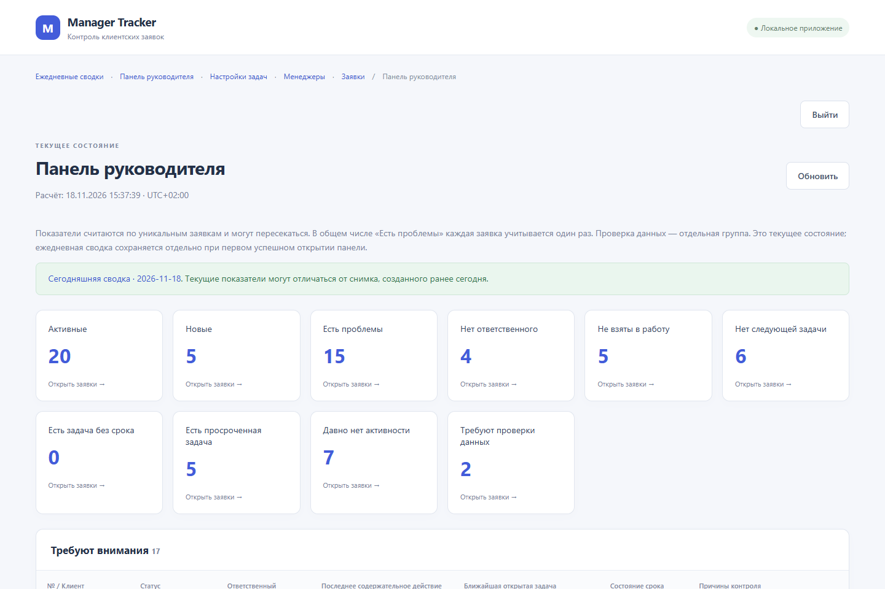
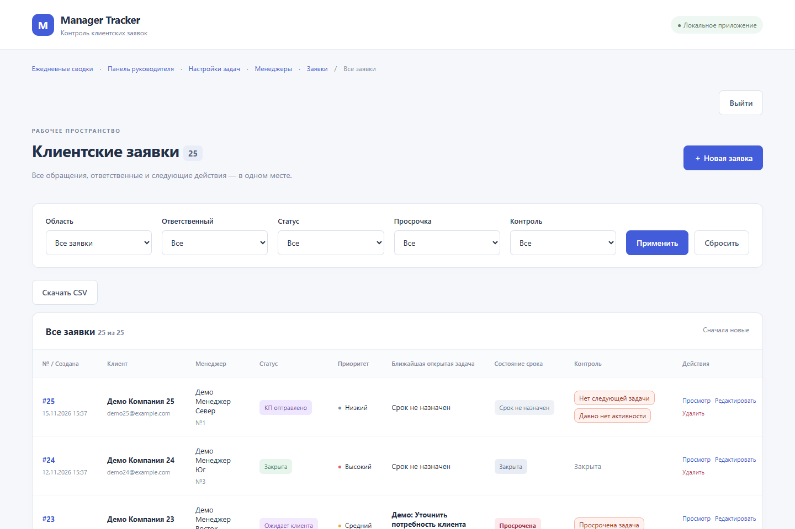
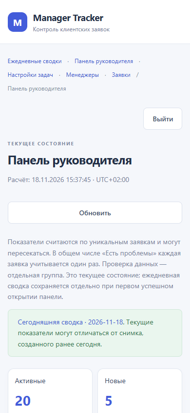

<!-- portfolio-case:v1 -->
# Manager Tracker — контроль заявок

Реестр заявок с ответственными, задачи менеджерам, история действий и ежедневные снимки проблемных заявок.

[Все проекты](https://github.com/gek-finn)

## Задача

Помочь руководителю находить заявки без следующего действия, просроченные задачи и обращения без активности.

## Что реализовано

- Статусы заявок, ответственные и задачи со сроками.
- Первичная задача после новой заявки и задача после отметки об отправке КП.
- Контроль просрочки, отсутствия следующего действия и активности.
- Панель руководителя, ежедневные сводки и CSV.
- Вход владельца, история событий и фильтры.

## Технологии

Python · Flask · SQLite · Jinja2 · HTML / CSS · JavaScript

## Статус и ограничения

Самостоятельная учебная реализация по мотивам FL.ru №5524183. Интеграция с amoCRM не реализована. КП и внешние уведомления приложение не отправляет; сводка создаётся при открытии панели.

## Приложение

[https://manager.gilinsky.ru](https://manager.gilinsky.ru) — Требуется вход владельца; открытого гостевого входа нет. Доступность сайта в рамках этой подготовки не проверялась.

## Интерфейс

### Панель руководителя

### Реестр заявок

### Мобильный экран

## Запуск

[Инструкция установки и запуска](docs/SETUP.md).

## О кейсе

Описание показывает реализованные функции. Подтверждённые показатели продаж, экономии времени и коммерческого внедрения в этом кейсе не заявляются.
